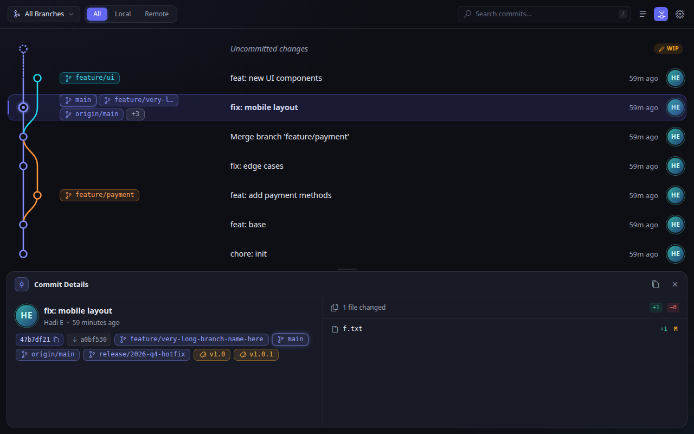
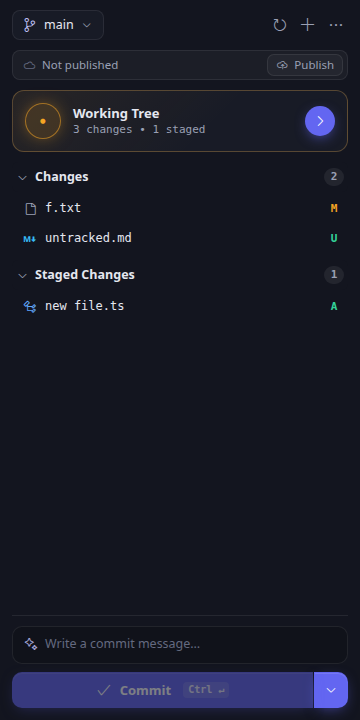
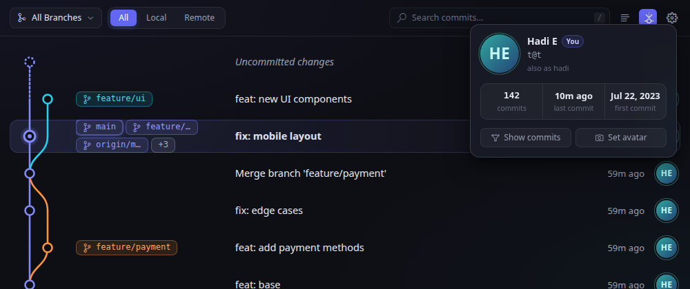
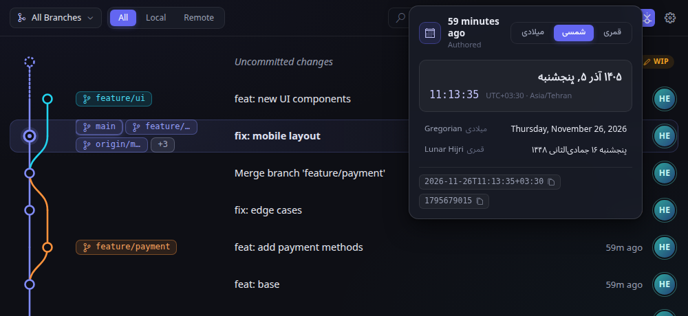
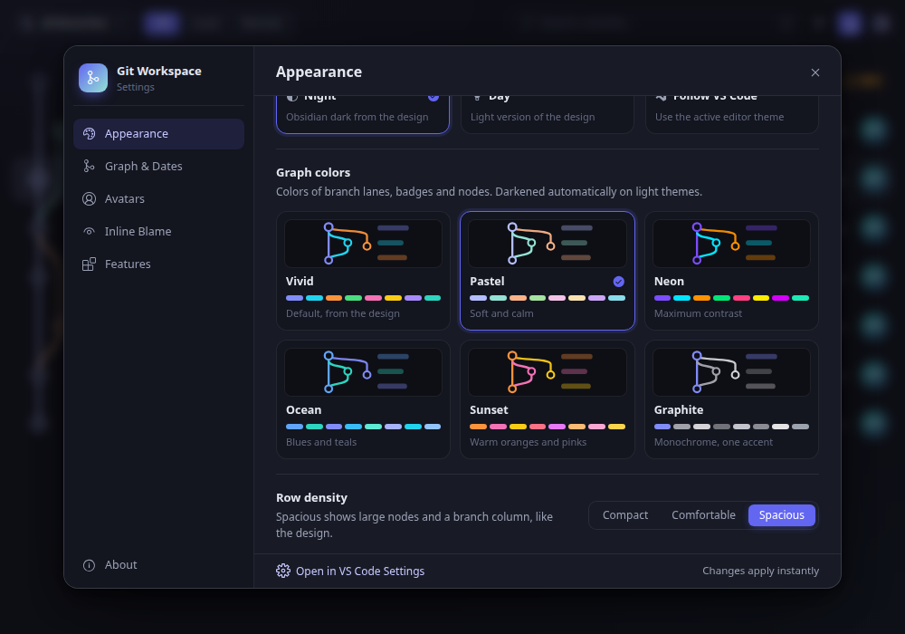
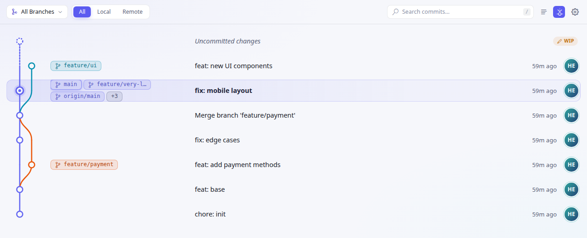

<div align="center">


# Git Workspace

**A modern Git graph, source control panel and inline blame for VS Code.**
Do your daily Git work without opening a terminal.

[](https://github.com/hadiesmaili/vscode-git-extentions/releases/latest)
[](https://github.com/hadiesmaili/vscode-git-extentions/actions/workflows/ci.yml)
[](https://code.visualstudio.com/)
[](LICENSE)



</div>

---

## Contents

- [Features](#features)
- [Install](#install)
- [Usage](#usage)
- [Settings](#settings)
- [Commands and shortcuts](#commands-and-shortcuts)
- [Privacy](#privacy)
- [Development](#development)
- [Releasing](#releasing)
- [Architecture](#architecture)
- [License](#license)

## Features

### Git Graph

- **Branch topology** drawn as smooth, colored lanes. HEAD, merge commits and uncommitted changes each have their own node style.
- **Three row densities.** *Compact*, *Comfortable* and *Spacious*. Spacious has large ring nodes and a separate column for branch badges.
- **Filters and search.** Show all, local or remote branches, or a single branch. Search by message, author, email, hash or ref, then jump between matches with <kbd>Enter</kbd>.
- **Commit details.** A resizable panel shows the message, parents and refs, and every changed file with its line counts. Click a file to open it in the VS Code diff editor.
- **Context menus.** Right-click a commit to check it out, create a branch or tag, cherry-pick, revert or reset (soft, mixed or hard). Right-click a branch badge to check it out, merge, rebase, push, rename or delete it.
- **Large histories.** The list is virtualized and loads more commits as you scroll.

### Source Control sidebar



- Switch and create branches. A sync strip shows how many commits are ahead (↑) and behind (↓).
- A working tree card summarizes your changes.
- Stage, unstage, discard and open files one at a time or all at once.
- Commit with <kbd>Ctrl</kbd>/<kbd>⌘</kbd>+<kbd>Enter</kbd>, or use *Commit & Push* and *Amend*.
- During a merge, rebase or cherry-pick, a banner offers **Abort** and **Continue**.
- Fetch, pull, push, publish and stash.

<br clear="right" />

### Hover cards

| Author card | Date card |
|---|---|
|  |  |
| Commit count, first and last activity, other names used with the same email, and a custom avatar. | Relative and full time with time zone, in the **Gregorian**, **Solar Hijri (Shamsi)** and **Lunar Hijri (Qamari)** calendars, plus ISO 8601 and Unix values. |

### Inline blame

The current line shows a faint note with the author, the time and the commit summary. Hover over it for details and an **Open in Git Graph** link. You can change the format and the delay.

### Themes and palettes



- **Night**, **Day** or **Follow VS Code** theme. The theme changes immediately, without reloading the view.
- Six lane color palettes: *Vivid*, *Pastel*, *Neon*, *Ocean*, *Sunset* and *Graphite*. On light themes they are darkened automatically so they stay readable.



## Install

1. Download the latest `git-workspace-x.y.z.vsix` from [**Releases**](https://github.com/hadiesmaili/vscode-git-extentions/releases/latest).
2. Install it:

   ```bash
   code --install-extension git-workspace-x.y.z.vsix
   ```

   Or, in VS Code, open **Extensions** → `···` → **Install from VSIX…**
3. Run **Developer: Reload Window**.

Requires VS Code 1.90 or newer and Git on your `PATH` (or set `git.path`).

## Usage

| What | How |
|---|---|
| Open the Git Graph | <kbd>Ctrl</kbd>+<kbd>Alt</kbd>+<kbd>G</kbd> (<kbd>⌘</kbd>+<kbd>Alt</kbd>+<kbd>G</kbd> on macOS), or the **Git Workspace** icon in the Activity Bar → arrow on the working tree card |
| Show or hide commit details | Click a commit, or press <kbd>Enter</kbd> / <kbd>Space</kbd> |
| Move between commits | <kbd>↑</kbd> <kbd>↓</kbd> <kbd>PgUp</kbd> <kbd>PgDn</kbd> <kbd>Home</kbd> <kbd>End</kbd> |
| Search | <kbd>/</kbd> or <kbd>Ctrl</kbd>+<kbd>F</kbd>, then <kbd>Enter</kbd> / <kbd>Shift</kbd>+<kbd>Enter</kbd> for the next or previous match |
| Check out a branch | Double-click its badge |
| Open settings | ⚙ button at the top right of the graph |

Reset hard, discard, delete, rebase and force operations always ask you to confirm first.

## Settings

Everything below can be changed from the ⚙ settings modal or from VS Code settings.

| Setting | Default | Description |
|---|---|---|
| `gitWorkspace.theme` | `brand` | `brand` (night), `light` (day) or `auto` (follow VS Code) |
| `gitWorkspace.graph.density` | `comfortable` | `compact`, `comfortable` or `spacious` |
| `gitWorkspace.graph.palette` | `vivid` | `vivid`, `pastel`, `neon`, `ocean`, `sunset` or `graphite` |
| `gitWorkspace.graph.pageSize` | `500` | Number of commits loaded per page |
| `gitWorkspace.calendar` | `gregory` | `gregory`, `persian` or `islamic-umalqura` |
| `gitWorkspace.avatars.gravatar` | `false` | Load avatars from Gravatar (see [Privacy](#privacy)) |
| `gitWorkspace.inlineBlame.enabled` | `true` | Show inline blame on the current line |
| `gitWorkspace.inlineBlame.format` | `${author}, ${timeAgo} • ${summary}` | Also supports `${hash}` and `${date}` |
| `gitWorkspace.inlineBlame.delay` | `150` | Delay in milliseconds before the blame appears |

## Commands and shortcuts

| Command | Shortcut |
|---|---|
| Git Workspace: Open Git Graph | <kbd>Ctrl</kbd>+<kbd>Alt</kbd>+<kbd>G</kbd> |
| Git Workspace: Refresh | |
| Git Workspace: Fetch / Pull / Push | |
| Git Workspace: Select Repository | |
| Git Workspace: Toggle Inline Blame | |

## Privacy

- Avatars default to **initials** and use no network access. Custom avatars are images you pick, stored locally in VS Code's global state.
- **Gravatar is off by default.** When you turn it on, an MD5 hash of each author email is sent to `gravatar.com`.
- Fetch, pull and push go through VS Code's built-in Git extension, so your existing credentials and authentication still work.

## Development

```bash
pnpm install
pnpm watch        # rebuild on change; press F5 in VS Code to launch the extension
pnpm test         # unit tests (parsers, graph layout)
pnpm typecheck
pnpm package      # production build + .vsix
```

## Releasing

Releases are automated with GitHub Actions ([`release.yml`](.github/workflows/release.yml)):

1. Bump `version` in `package.json` and add a `## [x.y.z]` section to [`CHANGELOG.md`](CHANGELOG.md).
2. Commit, then tag and push:

   ```bash
   git tag vX.Y.Z
   git push origin main --tags
   ```

3. The workflow checks that the tag matches `package.json`, runs the type check and tests, builds the `.vsix`, and publishes a **GitHub Release** with the changelog section as release notes.

## Architecture

```
Extension Host (Node)                         Webviews (React)
├─ git/         Git CLI client + parsers  ◀─RPC─▶  graph/     Git Graph panel
├─ graph/       lane layout (pure, tested)          sidebar/   Source Control view
├─ controller   every operation, confirmations      components/ cards, menus, settings
├─ blame        inline blame decorations            lib/        rpc, dates, palettes
└─ avatars      custom / Gravatar avatars
```

- All reads and writes go through the **Git CLI** via `execFile`. Commands are never passed through a shell.
- Webviews talk to the host through a typed RPC whose method list is an **allowlist**. Settings writes are validated per key.
- Diffs open in the built-in VS Code diff editor through a `gitws:` content provider.

More detail: [docs/PLAN.fa.md](docs/PLAN.fa.md) (project plan, in Persian) and [docs/DESIGN.md](docs/DESIGN.md) (design system).

## License

[MIT](LICENSE) © Hadi Esmaeili
